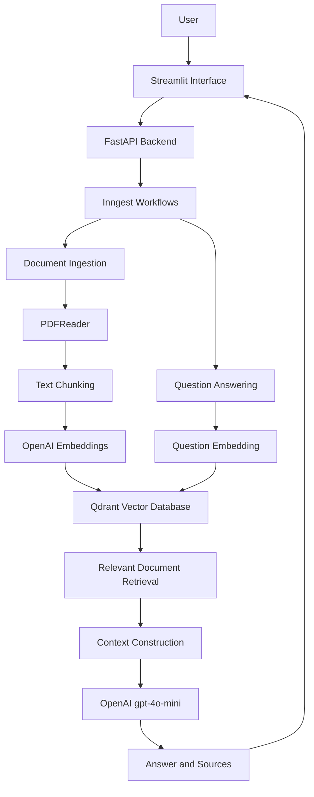

# 🤖 Production-Ready RAG AI Agent

An AI-powered document question-answering system built with **Python, FastAPI, OpenAI, Qdrant, LlamaIndex, Inngest, and Streamlit**. This application enables users to upload and query PDF documents using natural language, retrieving relevant information and generating context-aware answers with source references.

## 🚀 Overview

The RAG AI Agent implements a Retrieval-Augmented Generation (RAG) architecture to provide intelligent question answering over university lecture notes, academic research papers, study materials, and other PDF documents.

Instead of relying solely on an LLM's pre-trained knowledge, the application retrieves relevant information from uploaded documents and uses that context to generate more accurate and relevant responses.

The system separates document ingestion and question-answering into orchestrated workflows using Inngest, while Qdrant handles semantic vector storage and retrieval.

## ✨ Key Features

- **PDF Document Processing:** Extract text from PDF documents using LlamaIndex.
- **Intelligent Text Chunking:** Split extracted content into manageable, overlapping chunks.
- **Semantic Embeddings:** Generate 3072-dimensional embeddings using OpenAI `text-embedding-3-large`.
- **Vector Database:** Store and manage document embeddings using Qdrant.
- **Semantic Search:** Retrieve the most relevant document chunks using cosine similarity.
- **AI-Powered Question Answering:** Generate context-aware responses using OpenAI `gpt-4o-mini`.
- **Background Workflows:** Orchestrate document ingestion and question-answering tasks using Inngest.
- **Source References:** Return document source information alongside generated answers.
- **Interactive Interface:** Provide a user-friendly document interaction experience through Streamlit.
- **REST API:** Expose backend functionality through FastAPI.
- **Data Validation:** Use Pydantic models for structured workflow data.

## 🏗️ System Architecture

The application follows a Retrieval-Augmented Generation architecture consisting of two primary workflows.

### 1. Document Ingestion Pipeline

The ingestion pipeline transforms uploaded PDF documents into searchable vector representations.

1. Receive a PDF document.
2. Extract document text using LlamaIndex PDFReader.
3. Split the extracted text using SentenceSplitter.
4. Generate semantic embeddings using OpenAI `text-embedding-3-large`.
5. Store embeddings and document metadata in Qdrant.
6. Execute the ingestion process through an Inngest background workflow.

### 2. Question Answering Pipeline

The question-answering pipeline retrieves relevant document content and generates responses using an LLM.

1. Receive a natural-language question.
2. Generate an embedding for the question.
3. Perform semantic similarity search against Qdrant.
4. Retrieve the most relevant document chunks.
5. Construct a context-aware prompt.
6. Generate an answer using OpenAI `gpt-4o-mini`.
7. Return the generated answer together with source information.

### Architecture Diagram



## 🛠️ Technology Stack

| Category | Technologies |
|---|---|
| Programming Language | Python 3.12 |
| Backend Framework | FastAPI |
| AI / LLM | OpenAI gpt-4o-mini |
| Embedding Model | OpenAI text-embedding-3-large |
| RAG Framework | LlamaIndex |
| Vector Database | Qdrant |
| Workflow Orchestration | Inngest |
| Frontend | Streamlit |
| Data Validation | Pydantic |
| Environment Management | python-dotenv |
| Package Manager | uv |
| Development IDE | PyCharm |
| Containerization | Docker |
| Version Control | Git, GitHub |

## 📂 Project Structure

```text
rag-ai-agent/
│
├── custom_types.py       # Pydantic data models
│
├── data_loader.py        # PDF extraction, chunking and embeddings
│
├── main.py               # FastAPI application and Inngest workflows
│
├── vector_db.py          # Qdrant vector database operations
│
├── streamlit_app.py      # Streamlit user interface
│
├── pyproject.toml        # Project dependencies and configuration
│
├── uv.lock               # Locked dependency versions
│
├── .gitignore            # Git ignore configuration
│
├── .env                  # Environment variables (not committed)
│
└── README.md             # Project documentation
```

## ⚙️ Installation and Setup

### Prerequisites

Make sure the following tools and services are available:

- Python 3.12+
- [uv](https://docs.astral.sh/uv/)
- [Docker Desktop](https://www.docker.com/products/docker-desktop/)
- [OpenAI API Key](https://platform.openai.com/api-keys)
- [Inngest CLI](https://www.inngest.com/docs/quick-start)

### 1. Clone the Repository

```bash
git clone https://github.com/gtkk98/rag-ai-agent.git

cd rag-ai-agent
```

### 2. Install Dependencies

Install the project dependencies using uv:

```bash
uv sync
```

### 3. Configure Environment Variables

Create a `.env` file in the project root directory.

```env
OPENAI_API_KEY=your_openai_api_key
```

Replace the placeholder with your actual OpenAI API key.

**Important:** Never commit your `.env` file or expose your API keys publicly.

### 4. Start Qdrant

Run Qdrant locally using Docker:

```bash
docker run -d \
  --name qdrant \
  -p 6333:6333 \
  -p 6334:6334 \
  qdrant/qdrant
```

Qdrant will be accessible at:

```text
http://localhost:6333
```

The application automatically creates the `docs` collection with a vector dimension of 3072 and cosine similarity when it connects for the first time.

### 5. Start the FastAPI Backend

Run the backend:

```bash
uv run uvicorn main:app --reload
```

The backend will be available at:

```text
http://localhost:8000
```

FastAPI documentation:

```text
http://localhost:8000/docs
```

### 6. Start the Inngest Development Server

In a separate terminal, start the Inngest development server:

```bash
npx inngest-cli@latest dev -u http://localhost:8000
```

This connects the Inngest development environment to the FastAPI application and makes the registered workflows available for execution.

### 7. Launch the Streamlit Interface

Open another terminal and execute:

```bash
uv run streamlit run streamlit_app.py
```

The Streamlit application will be available at:

```text
http://localhost:8501
```

## 🔄 Workflow Events

The application uses Inngest to manage two primary workflows.

| Workflow | Event Name | Responsibility |
|---|---|---|
| PDF Ingestion | `rag/ingest_pdf` | Extract, chunk, embed, and store PDF content |
| PDF Question Answering | `rag/query_pdf_ai` | Retrieve relevant information and generate answers |

Inngest provides structured workflow execution through named steps, helping organize and monitor the processing pipeline.

## 🧠 RAG Configuration

The following configurations are used in the current implementation.

| Component | Configuration |
|---|---|
| Embedding Model | `text-embedding-3-large` |
| Embedding Dimensions | 3072 |
| LLM | `gpt-4o-mini` |
| Chunk Size | 1000 tokens |
| Chunk Overlap | 200 tokens |
| Vector Database | Qdrant |
| Collection Name | `docs` |
| Similarity Metric | Cosine Similarity |
| Retrieval Limit | Top 5 results |

## 🔐 Security Considerations

- Store API keys in environment variables rather than source code.
- Keep `.env` files excluded from version control.
- Use appropriate access controls when exposing services publicly.
- Configure production-specific settings before deployment.
- Avoid exposing internal infrastructure endpoints to untrusted clients.

## 🚧 Future Improvements

Potential enhancements for future iterations include:

- [ ] PostgreSQL integration for persistent application metadata and user management.
- [ ] User authentication and authorization.
- [ ] Support for additional document formats.
- [ ] Advanced document metadata filtering.
- [ ] Improved retrieval using reranking techniques.
- [ ] Streaming AI responses.
- [ ] Docker Compose-based deployment.
- [ ] Automated testing and CI/CD integration.
- [ ] Production deployment with cloud infrastructure.
- [ ] Improved observability, logging, and error handling.

## 👨‍💻 Author

**G. G. Thilina Kumarasiri**

Undergraduate Software Engineer | AI Engineering

- **GitHub:** [@gtkk98](https://github.com/gtkk98)
- **LinkedIn:** [Thilina Kumarasiri](https://www.linkedin.com/in/thilina-kumarasiri-7970a02b7/)

## 📄 License

This project is intended for educational purposes, practical AI engineering experience, and portfolio development.

---

⭐ If you find this project useful, consider giving the repository a star!

**Repository:** [rag-ai-agent](https://github.com/gtkk98/rag-ai-agent)
